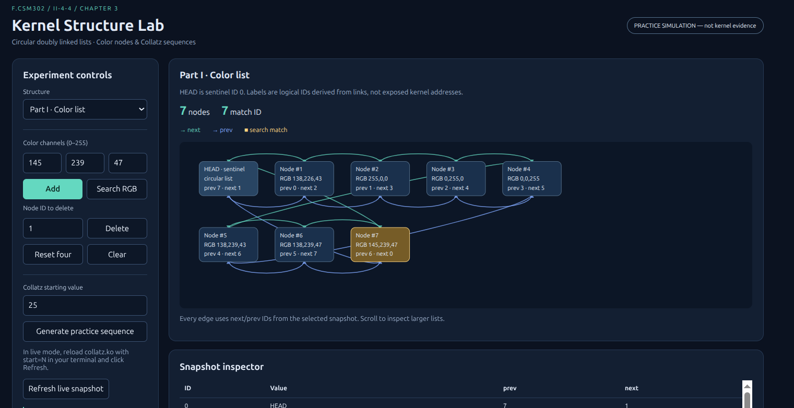
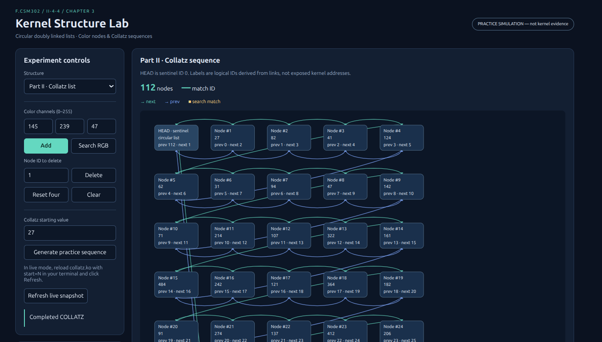
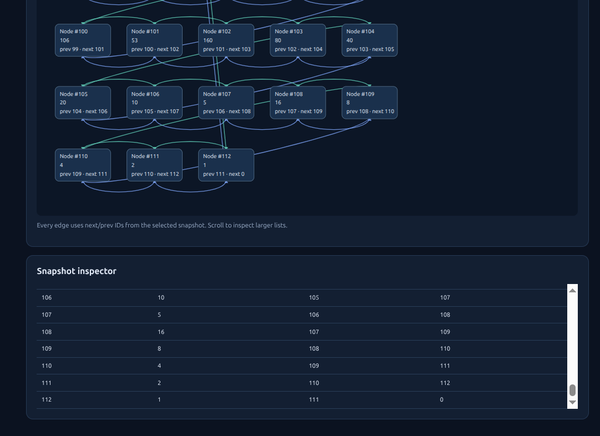
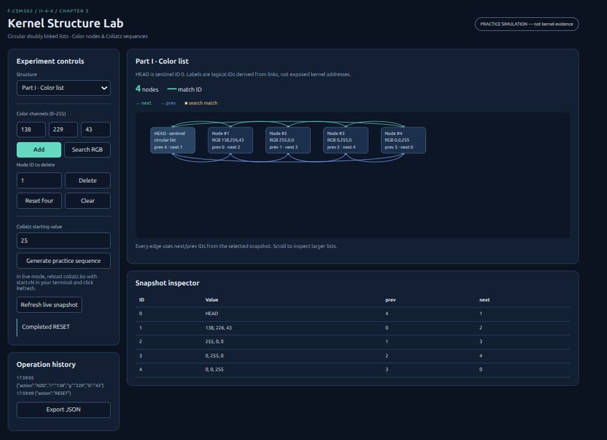

# БИЕ ДААЛТЫН ТАЙЛАН — Kernel Data Structures

**ШИНЖЛЭХ УХААН ТЕХНОЛОГИЙН ИХ СУРГУУЛЬ**
**МЭДЭЭЛЭЛ, ХОЛБООНЫ ТЕХНОЛОГИЙН СУРГУУЛЬ**

ҮЙЛДЛИЙН СИСТЕМ (F.CSM302) · 2026–2027 оны хичээлийн жилийн намар

**Баг:** II-4-4  
**Сэдэв:** Kernel Data Structures  
**Багш:** Г. Ганбат /F.CS10/  
**Огноо:** 2026-11-01

| Гишүүн | Оюутны код |
| --- | --- |
| --- | --- |
| Э.Тэргэл | B210930801 |
| Б.Булгантамир | B241940123 |
| Т.Төгөлдөр | B242270050 |
| И.Зэлмэ | B231940158 |
| О.Амина | B241910800 |
| М.Наранбат | B242270801 |

**Repository:** [Tergel0923/CSM302-II-4-4](https://github.com/Tergel0923/CSM302-II-4-4)

**PDF хувилбар:** [II-4-4_BD1_Report.pdf](II-4-4_BD1_Report.pdf)

## Гарчиг

1. [Удиртгал](#1-удиртгал)
2. [Сурах бичгийн шаардлага](#2-сурах-бичгийн-шаардлага)
3. [Онолын үндэс](#3-онолын-үндэс)
4. [Системийн зохиомж](#4-системийн-зохиомж)
5. [Хэрэгжилт](#5-хэрэгжилт)
6. [Туршилт ба UI дүрслэл](#6-туршилт-ба-ui-дүрслэл)
7. [Туршилтын арга](#7-туршилтын-арга)
8. [Бодит үр дүн ба нотолгоо](#8-бодит-үр-дүн-ба-нотолгоо)
9. [Хэлэлцүүлэг](#9-хэлэлцүүлэг)
10. [Дүгнэлт](#10-дүгнэлт)

## Хураангуй
Linux цөмд өгөгдлийг динамикаар хадгалах, холбоосоор дамжин боловсруулах, ашигласан санах ойг буцаан чөлөөлөх ажиллагааг судлав. Part I-д дөрвөн RGB өнгийн элемент бүхий intrusive circular doubly linked list, Part II-д start параметрээс үүсэх Collatz дарааллыг тус тус kernel module болгон хэрэгжүүлэв.
Python HTTP adapter нь /proc интерфейсээс бүтцийн төлөвийг уншиж, HTML/SVG UI-д next/prev холбоог харуулна. Элемент нэмэх, ID-аар устгах, RGB-ээр хайх, хоослох, анхны төлөвт оруулах командуудыг цөмд дамжуулна.
Локал орчинд Python болон HTTP тестүүд, kernel-тэй хамт ашигладаг C арифметикийн тестийг ажиллуулсан. Баталгаажуулалтын дэлгэрэнгүй ба дутуу хэсгийг 8-р хэсэгт ялгасан. Practice mode-ийн үр дүнг kernel runtime-ийн нотолгоо гэж үзээгүй.

## 1. Удиртгал

### 1.1 Зорилго

Төслийн зорилго нь kernel дахь санах ой хуваарилалт, intrusive list, жагсаалтаар гүйх үйлдэл, аюулгүй устгал, module-ийн амьдралын мөчлөг, мөн user болон kernel орчны заагийг бодит кодоор тайлбарлах явдал юм.

### 1.2 Ач холбогдол

Үйлдлийн систем нь процесс, төхөөрөмж, нөөцийн бүртгэлийг динамик өгөгдлийн бүтцээр зохион байгуулдаг. Linked list нь урт нь урьдчилан тогтоогдоогүй бөгөөд node-ийн хаяг мэдэгдэж байвал холбоосыг тогтмол хугацаанд өөрчлөх боломжтой. Харин хайлт хийхдээ бүх элементийг дарааллаар нь шалгах шаардлагатай.

### 1.3 Хамрах хүрээ

Төсөл нь Part I-ийн RGB өнгөтэй intrusive circular doubly linked list kernel module, Part II-ийн start параметрээс үүсэх Collatz дарааллын тусдаа kernel module, `/proc` интерфейс, локал Python HTTP adapter, graph UI болон автомат тестийг хамарна. Production authentication, remote hosting, олон browser-ийн тусгаарлагдсан session төлөв нь төслийн хүрээнд ороогүй.

## 2. Сурах бичгийн шаардлага

### 2.1 Эх сурвалж
Эх сурвалж: Operating System Concepts, 10th edition, Chapter 3, Programming Project 4, printed P-19–P-22. Номын Part II нь заавал хийх тусдаа Collatz module юм.
### 2.2 Шаардлага ба хэрэгжилтийн харьцуулалт

| Шаардлага | Хэрэгжилт |
| --- | --- |
| Part I: init дээр дөрвөн color | colors_init → reset_list |
| List traversal ба kernel log | list_for_each_entry + pr_info |
| Exit дээр delete, free | list_for_each_entry_safe + list_del + kfree |
| Part II: start параметр | collatz.ko, module_param(start, ullong, 0) |
| Collatz list ба traversal | sequence list, value, id, next/prev |
| Add/delete/search дараах graph | /proc/kds_colors + interactive SVG |
| Өөр оролт, boundary/error | RGB, ID, capacity, overflow validation |
| Дахин ажиллуулах | README, Manual, tests, Makefile |

### 2.3 Хуваарилалт

Сургалтын хуваарьт II-4-4 нь 4-р сэдэв бөгөөд UI нь Цөмийн бүтцийн граф байна. Шүүмжлэх баг нь IV-2-7; тэдний 7-р сэдэв Fork-Join Sorting Application юм.

## 3. Онолын үндэс
### 3.1 Intrusive circular doubly linked list

#### 3.1.1 Бүтэц
struct color дотор RGB өгөгдлөөс гадна struct list_head байрлана. list_head нь next ба prev холбоосыг агуулна. Өгөгдлийн node бүр холбоосоо өөртөө агуулдаг тул intrusive гэж нэрлэнэ.
#### 3.1.2 HEAD sentinel

HEAD нь өгөгдлийн элемент биш, sentinel юм. Хоосон үед HEAD.next ба HEAD.prev өөр рүүгээ заана. Элементтэй үед HEAD.next эхний, HEAD.prev сүүлийн node руу заана. Сүүлийн node-ийн next болон эхний node-ийн prev нь HEAD рүү буцна.
#### 3.1.3 Logical ID

UI нь kernel address-ийг задруулахгүй. ID 0 нь HEAD; node ID-уудыг list_head холбоосоос node_id() функцээр гаргана. Тиймээс next/prev утга нь зүгээр frontend-ийн жагсаалтын индекс биш.
### 3.2 Алгоритмын өртөг

| Үйлдэл | Хугацаа | Тайлбар |
| --- | --- | --- |
| Tail insert | O(1) | list_add_tail |
| RGB search | O(n) | эхний тохирох элемент |
| Устгах by ID | O(n) | хайсны дараах unlink O(1) |
| Traversal / graph snapshot | O(n) | элемент бүрийг уншина |
| Хоослох / unload | O(n) | node бүрийг kfree |
| Санах ой | O(n) | node ба хоёр холбоос |

### 3.3 Collatz дараалал
Эхлэх n нь эерэг бүхэл тоо. n тэгш бол n/2; сондгой бол 3n+1. n=1 хүрэхэд зогсоно. Бүх эерэг тоонд төгсөнө гэдэг нь батлагдсан теорем биш тул 4096 node-ийн хамгаалалттай. Unsigned 64-bit overflow болохоос өмнө n > (ULL_MAX-1)/3 шалгана.

## 4. Системийн зохиомж

### 4.1 Компонент ба өгөгдлийн урсгал
Browser → loopback Python HTTP adapter → /proc/kds_colors → colors.ko → kernel list гэсэн урсгалаар команд дамжина. Командын дараа шинэ snapshot уншиж граф, хүснэгт, match ID-г шинэчилнэ.
Collatz module нь load үед list-ээ бүтээж, дараа нь immutable snapshot өгнө. Параметр солихдоо terminal-аас unload/load хийнэ; UI Шинэчлэх нь шинэ snapshot-ийг уншина. Web server-ээс shell команд ажиллуулахгүй.
### 4.2 Интерфейсийн гэрээ

| Команд | Утга / үр дүн |
| --- | --- |
| ADD r g b | 0–255 RGB; шинэ logical ID |
| SEARCH r g b | Эхний тохирох ID; байхгүй бол 0 |
| DELETE id | ID-аар устгах; байхгүй бол ENOENT |
| CLEAR | Бүх node-ийг чөлөөлөх |
| RESET | Анхны дөрвөн node; ID 1–4 |

/proc JSON нь kind, head.next, head.prev, nodes болон colors-ийн found утгыг өгнө. Collatz value-ийг JSON string хэлбэрээр өгснөөр JavaScript-ийн 53-bit integer хязгаараас үүсэх алдагдлыг зайлуулна.
### 4.3 Зэрэгцээ хандалт ба эрх
colors-ийн read/write үйлдлүүд нэг mutex ашиглана. RESET нь шинэ list-ээ бүрэн allocate хийсний дараа хуучныг солино; allocation алдаа гарвал хуучин төлөв үлдэнэ. proc_remove нь unload үед interface-ийг салгаж, дараа нь memory cleanup хийнэ.
Proc файлууд root-only. Write нь CAP_SYS_ADMIN шалгана. Server нь 127.0.0.1 дээр ажиллаж, Host, Origin болон session token-ийг POST бүр дээр шалгана. Энэ нь сургалтын VM-д зориулсан локал хэрэгсэл бөгөөд production service биш.

## 5. Хэрэгжилт

### 5.1 colors.c
colors.c нь list.h, kmalloc/kfree, mutex, proc_ops, seq_file ашиглана. RGB parser нь kstrtoint, ID parser нь kstrtouint ашиглаж, хэт том тоо, дутуу/илүү token, embedded NUL-ийг буцаана. Багтаамж нь 128 node. Давхардсан RGB зөвшөөрөгдөнө; node бүр өөр ID-тай.
reset_list нь түр list үүсгэнэ. Дөрвөн allocation амжилттай болсны дараа list_splice_tail_init хийж шилжүүлнэ. clear_list нь safe iterator-аар устгана. ID нь CLEAR үед дахин 1 болохгүй; RESET үед 1–4 болж эхэлнэ.

*Зураг 1. Practice горим: 7 өнгийн node-оос RGB (145, 239, 47)-тай ID 7 элементийг хайж тодруулсан байдал.*

### 5.2 collatz.c

collatz.c нь start параметрийг авч linked list үүсгэнэ. Allocation, overflow, capacity эсвэл proc_create алдаа гарвал бүтээсэн бүх node-ийг чөлөөлж module load-ийг алдаатай дуусгана. Төгсгөлийн 1 утгыг list-д хадгална.

*Зураг 2. Practice горим: start=27 параметртэй Collatz дараалал, 112 node.*

*Зураг 3. Practice горим: Collatz дарааллын төгсгөлийн value=1 болон prev/next холбоосын хүснэгт.*

## 6. Туршилт ба UI дүрслэл

### 6.1 UI-ийн бүтэц
Зүүн талын control panel нь RGB, ID, start оролт болон командын товчтой. Баруун талд HEAD ба node-ууд, ногоон next, цэнхэр prev холбоос, хайлтын шар хүрээ, snapshot хүснэгт харагдана. Graph-ийн node/edge нь snapshot-ийн logical ID-тай таарна.

*Зураг 4. Practice горим: анхны дөрвөн өнгө, HEAD sentinel, next/prev сум, snapshot хүснэгт болон үйлдлийн түүх.*

### 6.2 Operation history ба export

Үйлдлийн түүх нь тухайн browser session-ийн амжилттай команд, timestamp, snapshot-ийг хадгална. JSON файл татах нь төлөв болон history-г татна. Энэ нь kernel log-ийг орлохгүй; dmesg нотолгоог тусад нь хадгална.
### 6.3 Practice simulation ба Live mode

Practice simulation нь Windows/Linux/macOS дээр kernel module-гүй ажиллана. Live mode нь module байхгүй үед алдааг харуулж, practice руу нууцаар шилжихгүй. Practice screenshot-ийг live kernel screenshot гэж тайлагнах ёсгүй.

## 7. Туршилтын арга

### 7.1 Туршилтын түвшин
Локал тестүүд нь model/validation, HTTP contract, kernel module-д ашигладаг shared pure C arithmetic гэсэн гурван түвшинтэй. Kernel acceptance script нь тусдаа Ubuntu VM дээр бодит module-ийг insmod/rmmod хийж /proc-г шалгах зориулалттай.
### 7.2 Туршилтын тохиолдлууд

| Тест | Оролт | Хүлээгдсэн үр дүн |
| --- | --- | --- |
| Анхны жагсаалт | load/reset | 4 node, circular reciprocal links |
| CRUD | ADD 10 20 30, SEARCH, DELETE | ID 5; олдоно; дараа нь устна |
| Захын элемент устгах | 1, 3, 4, 2 ID | Хоосон HEAD self-links |
| Байхгүй элемент | DELETE 999 | Алдаа; төлөв өөрчлөгдөхгүй |
| Буруу RGB утга | -1, 256, text, 2^32 | Татгалзана |
| Давхардсан өнгө | Red нэмэх, хайх | Эхний тохирох ID 2 |
| Багтаамж | 128 дараа 129 дэх | ENOSPC; list хэвээр |
| Collatz | 1 / 15 / 25 / 27 | 1 / 18 / 24 / 112 nodes |
| Тоон хязгаар давах | ULL_MAX | Load/generation татгалзана |
| HTTP хандалтын шалгалт | No token / foreign Origin | 403 |

### 7.3 Номын параметрийн жишээ
start=15 үед: 15 → 46 → 23 → 70 → 35 → 106 → 53 → 160 → 80 → 40 → 20 → 10 → 5 → 16 → 8 → 4 → 2 → 1.
### 7.4 Kernel acceptance

Kernel acceptance нь edge бүрийн next.prev болон prev.next invariant-ийг шалгана. Unload дараа /proc entry арилсныг шалгана. dmesg нь load traversal, cleanup тоог баталгаажуулах баримт болно. Cleanup log ганцаараа memory leak байхгүйг бүрэн нотлохгүй; kmemleak зэрэг kernel instrumentation нэмэлтээр ашиглаж болно.

## 8. Бодит үр дүн ба нотолгоо

### 8.1 Локал автомат шалгалт
2026-11-01-нд local automation ажиллуулсан. Raw log: [local-tests.txt](evidence/local-tests.txt). ASAN_OPTIONS=detect_leaks=0 тохируулсан нь энэ container-ийн LeakSanitizer process inspection хязгаарлалтаас шалтгаалсан.

| Шалгалт | Бодит төлөв |
| --- | --- |
| Python model + HTTP | 22 test АМЖИЛТТАЙ |
| Shared C arithmetic | GCC, ASan/UBSan АМЖИЛТТАЙ |
| JavaScript parsing | Syntax АМЖИЛТТАЙ |
| Цөмийн модуль бүтээх | АМЖИЛТТАЙ: Ubuntu 6.8.0-138 headers, W=1 |
| Модуль ачаалах/буулгах | Энэ орчинд ажиллуулаагүй |
| Бодит горимын дэлгэцийн зураг | Баг Ubuntu VM дээр авна |
| Хөтчийн дүрслэлийн баталгаажуулалт | Browser binary байхгүй тул хүлээгдэж буй |

### 8.2 Kernel compilation

Хоёр module Ubuntu 6.8.0-138-generic headers, GCC 13.3.0 дээр W=1 тохиргоотой compile/link амжилттай. Raw log: [kernel-build.txt](evidence/kernel-build.txt). Compiler package revision зөрүүний warning болон vmlinux байхгүйгээс BTF skip гарсан; source warning гараагүй. Host kernel 6.18.57 тул энэ .ko-г load хийгээгүй.
### 8.3 Screenshot-ийн шаардлага

Энд бодит kernel runtime screenshot зохиож оруулаагүй. Эцсийн submission-д colors initial state, search highlight, empty list, Collatz 15 болон dmesg load/unload screenshot-ийг нэмэх шаардлагатай. Зураг бүр дээр mode, оролт, хүлээгдсэн/бодит үр дүн, огноо, kernel version-ийг тэмдэглэнэ.
## 9. Хэлэлцүүлэг

### 9.1 Үр дүнгийн тайлбар
Kernel implementation ба practice model-ийн ижил үр дүн нь бүх kernel-specific алдааг үгүйсгэхгүй. Allocation failure, kernel locking, module removal, ABI compatibility нь live орчинд шалгах асуудал хэвээр. Kernel headers дээр compile амжилттай байх нь ажиллаж буй kernel дээр load амжилттайг батлахгүй.
### 9.2 Хязгаарлалт

UI нь kernel pointer address биш logical topology-г харуулдаг. Их хэмжээний Collatz list дээр SVG өндөр болно; scroll болон snapshot хүснэгтээр шалгана. Production authentication, remote hosting, олон browser-ийн тусгаарласан session state энэ төслийн хамрах хүрээнд ороогүй.

## 10. Дүгнэлт

### 10.1 Хэрэгжсэн зүйл ба нотолсон үр дүн
Номын хоёр хэсэгт зориулсан kernel module, add/delete/search/reset интерфейс, graph UI, automation болон дахин ажиллуулах баримт бичгийг боловсруулав. Локал тестүүд нь input validation, model invariants, HTTP interface, Collatz arithmetic-ийн сонгосон нөхцөлийг баталсан.
Бүрэн submission гэж үзэхээс өмнө Ubuntu VM дээр kernel build/load/run/unload, live UI болон бодит screenshot-ийг баталгаажуулна. Тайлангийн баталгаажуулалтын төлөвийг зөвхөн тухайн бодит үр дүнгээр шинэчилнэ.
### 10.2 GitHub ажиллагаа ба AI хэрэглээ
Ажлын эхэнд repository-д README болон placeholder folders байсан. Эхний бэлтгэлийн үед GitHub connection read-only байсан. Дараа нь repository owner account холбож, source, tests, docs-ийг GitHub-д нийтлэх боломж нээгдэв.
ChatGPT/Codex-ийг код, тест, UI, тайлан, Manual боловсруулахад ашигласан. Python стандарт сан, Linux kernel API, PDF-д ReportLab ашиглав.

## Ашигласан материал

1. A. Silberschatz, P. B. Galvin, G. Gagne. *Operating System Concepts*. 10th edition. Wiley, 2018. Chapter 3, Programming Project 4, P-19–P-22; Section 1.9.
2. Linux Kernel Documentation. [Linked Lists in Linux](https://docs.kernel.org/core-api/list.html).
3. Linux Kernel Documentation. [seq_file](https://docs.kernel.org/filesystems/seq_file.html).
4. Linux Kernel Documentation. [Building External Modules](https://docs.kernel.org/kbuild/modules.html).
5. F.CSM302 Бие даалт 1-ийн удирдамж, сэдэв ба шүүмжийн хуваарилалт, Peer Review удирдамж (өгсөн PDF файлууд).
